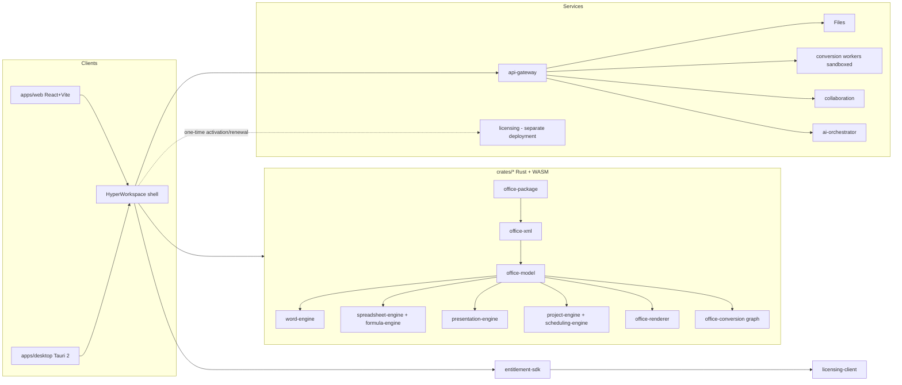

# Target state

## Layering of every document format

1. **Package layer**: ZIP/OLE, content types, relationships, unknown-part preservation, signatures, encryption envelope.
2. **Semantic model**: stable IDs, validation, change tracking.
3. **View/edit model**: selections, commands, undo/redo, layout cache, virtualisation, collaboration ops, accessibility tree.

## Cross-cutting

- Capability manifests are the only source of support claims (L0–L6).
- Every compatibility claim above L4 requires an REA investigation and reviewed report.
- Entitlements are enforced in UI, application services, server APIs, workers, and the extension host.
- Hostile-input limits are centrally configured ([file-processing.md](../security/file-processing.md)).
- Telemetry excludes document content by default.

The full target directory layout is the one in the master engineering brief;
modules are created only when they have a manifest, README, public API, tests,
owner, and status.
