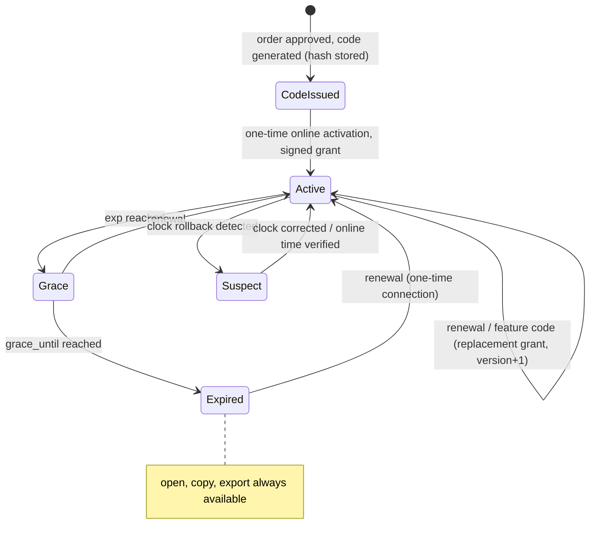

# Licensing Guide

Single entry point to the HyperOffice commercial licensing, activation, renewal,
and feature-entitlement system.

> **Status:** L0 design complete (draft, awaiting review); L1 implemented with
> development and test keys only. No production key exists. No real billing is
> connected. Production codes must not be issued until phases L0–L6 pass
> security review.

## 1. Principles

1. Asymmetric signatures prove a licence came from HyperOffice; SHA-256 is used
   only for hashing and fingerprints.
2. The private signing key lives only in Azure Key Vault / Managed HSM.
3. One online activation; afterwards the licence works offline.
4. Customer files are never held hostage.
5. Enforcement happens in services, workers, and the extension host — not only in the UI.
6. Privacy: licensing never sees documents; device data is minimal and hashed.

## 2. Lifecycle

## 3. Building blocks

| Component | Location | Role |
| --- | --- | --- |
| licensing-core | `packages/licensing-core` | Token format, strict verification, claims, calendar policies, code format |
| licensing-client | `packages/licensing-client` | Offline validation, clock guard, device binding, grant storage, requests |
| entitlement-sdk | `packages/entitlement-sdk` | Feature gate; capability catalogue |
| Licensing service | `services/licensing` | Code issuance, activation, renewal, audit (logic only) |
| Development issuer | `tools/development-license-issuer` | Local grants with per-machine dev keys |
| Schemas | `schemas/licensing` | Grant, entitlement, requests/responses, key set |
| Contract | `services/licensing/openapi`, `migrations` | REST and database design |

## 4. Products, editions, modes

See [commercial-model.md](commercial-model.md). Defaults: 6 calendar months,
14-day grace, renewal from `max(expiry, now)`; all configurable on the server.

## 5. Codes

| Type | Purpose | Use |
| --- | --- | --- |
| Activation Code | First activation | Up to `max_installations` installations |
| Renewal Code | Extend term | Single use |
| Feature Code | Add features/seats/installations | Single use |

Format and generation: [activation-code-format.md](activation-code-format.md).

## 6. The licence grant

Compact JWS, header `{typ: "HYPEROFFICE-LICENSE+jws", alg: "EdDSA"|"ES256", kid, ver: 1}`.
Claims: issuer, audience, IDs (`jti`, licence, customer, order), edition, mode,
products, features, limits, installation ID, device binding, licence/policy
version, `iat`, `nbf`, `exp`, `grace_until`. Schema:
[license-grant.schema.json](../../schemas/licensing/license-grant.schema.json).

## 7. Flows

- Activation: [technical-design-document.md §6.2](../technical-design-document.md#62-activation-sequence)
- Offline validation: [local-verification.md](local-verification.md)
- Clock rollback: [clock-rollback.md](clock-rollback.md)
- Renewal and feature codes: [renewal-flow.md](renewal-flow.md)
- Extension packages: [extension-package-signing.md](extension-package-signing.md)

## 8. Roles and separation of duties (Designed)

| Role | May |
| --- | --- |
| Licensing Viewer | Read licences and activations |
| Licensing Support | Inspect and reset activations |
| Licensing Operator | Issue codes from approved orders |
| Licensing Manager | Approve manual grants and bulk issuance |
| Security Administrator | Manage roles and security policy |
| Key Custodian | Manage signing-key lifecycle; cannot issue codes |
| Auditor | Read-only, including audit chain |

No role can export private signing keys.

## 9. Security and privacy

[Threat model](threat-model.md) · [Security test plan](security-test-plan.md) ·
[Key management](key-management.md) · [Privacy data map](privacy.md)

## 10. Operations and support

[Customer support procedures](customer-support.md) · [Operational runbook](operational-runbook.md)

## 11. Status and roadmap

[Implementation backlog](implementation-backlog.md). Summary:

| Phase | Scope | Status |
| --- | --- | --- |
| L0 | Threat model, policy, schemas, ADRs, privacy map | Done (draft) |
| L1 | Dev key, local issuer, JWS, verifier, feature gates, tests | Done |
| L2 | PostgreSQL, code generator, activation endpoint, rate limits, audit | Logic done; no HTTP/DB adapter |
| L3 | Secure storage, binding, grace, clock defence, read/export mode | Libraries done; platform adapters and UI not started |
| L4 | Renewal, feature codes, deactivation, support reset | Renewal/feature done; others not started |
| L5 | Key Vault signer, rotation, key distribution, DR | Not started |
| L6 | Extension package signing | Designed |
| L7 | Admin portal, billing, EN/AR screens, dashboards | Not started |
| L8 | Security review, pen test, DR and key-compromise exercises | Not started |
