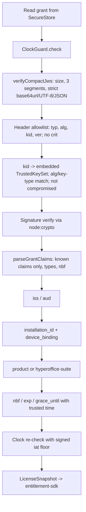

# Local verification design

Runs at every launch and before every licensed capability. Never contacts the server.

## Result statuses

`ALLOWED`, `GRACE_PERIOD`, `EXPIRED`, `NOT_YET_VALID`, `NOT_ENTITLED`,
`INVALID_SIGNATURE`, `WRONG_INSTALLATION`, `UNSUPPORTED_LICENSE_VERSION`,
`CLOCK_TAMPER_SUSPECTED`, `LICENSING_COMPONENT_UNAVAILABLE`.

Signature and binding failures are never masked by clock results.

## Trust store

- Built from public JWKs embedded in the application (`trustedKeySetFromJwks`).
- Product builds pass `["production"]` as allowed environments; development builds
  pass `["development"]`; tests pass `["test"]`. Keys from other environments are rejected.
- Builds ship the current key and the next rotation key. Retired keys stay until
  every grant they signed is past `grace_until`. Compromised keys are marked
  `compromised` in an emergency client update.
- The remote key-set URL is informational; validation never depends on it.

## Device binding

- `device_fingerprint = SHA-256(product_salt ‖ length-prefixed allowlisted signals)`.
- Allowlist: `machine_id`, `os_install_id`, `system_volume_id`, `board_serial`,
  `cpu_model`, `os_family`. MAC addresses, paths, network scans, location are refused.
- Per-signal salted hashes are kept locally. `matchDevice` scores weighted matches
  (threshold 0.6) so disk/NIC/RAM changes and OS updates do not break the binding.
  A failed match leads to re-activation or a support reset, never data loss.

## Storage

`SecureStore` adapters (DPAPI, Keychain, Secret Service, reduced-assurance file
store on Linux) are Phase L3. `GrantStore`:

- validates a replacement before writing;
- refuses equal or lower `license_version` for the same licence;
- keeps the superseded grant for controlled rollback;
- leaves the existing grant untouched if the write fails.

Also stored: installation ID, trusted-time state, grant hash, last update time.

## Failure behaviour

Licensed capabilities fail closed. Data-access capabilities (open, copy,
export to an open format) are always allowed, including when the licensing
component throws.
