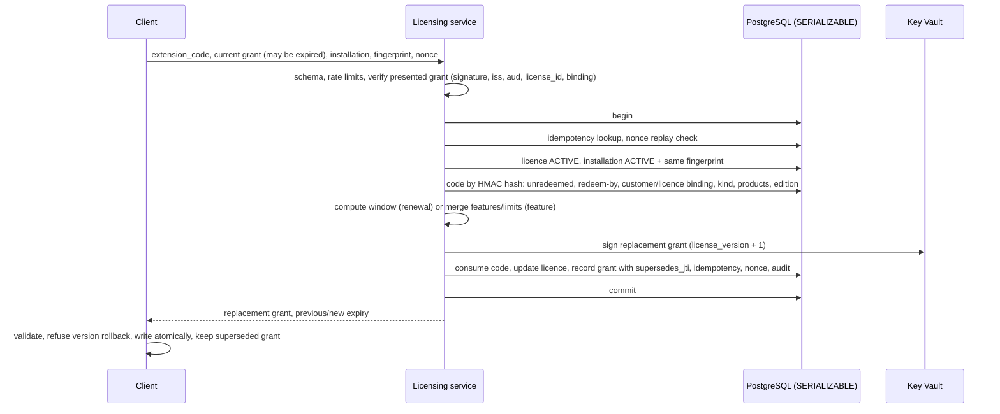

# Renewal and feature-code flow

`POST /v1/licenses/{license_id}/renewals` with an `Idempotency-Key` header.

## Policies

| Policy | Start | Use |
| --- | --- | --- |
| `max-current-expiry-or-now` (default) | max(current expiry, now) | Never loses remaining time |
| `current-expiry` | current expiry | Strict continuity (may produce past start for late renewals) |
| `purchase-date` | code issue date | Promotional terms |
| `activation-date` | original activation | Anniversary billing |
| `co-terminate` | now → template `coTerminateAt` | Enterprise alignment |

Feature codes: features are unioned; `limits` are increments; an optional term
extends from `max(current expiry, now)`.

The applicable policy must be shown before purchase.

## Failure handling

- All business failures return the same `RENEWAL_FAILED` body; the reason is audited.
- Signing failure rolls back the whole transaction; the code is not consumed.
- Client write failure leaves the previous grant installed (`STORAGE_FAILED`).

## Test coverage

Early, late (after grace), month-end, concurrent single-use, idempotent retry,
wrong customer, wrong code kind, tampered grant, IDOR (path mismatch), feature
merge. See `services/licensing/tests/unit/renewal.test.ts`.
