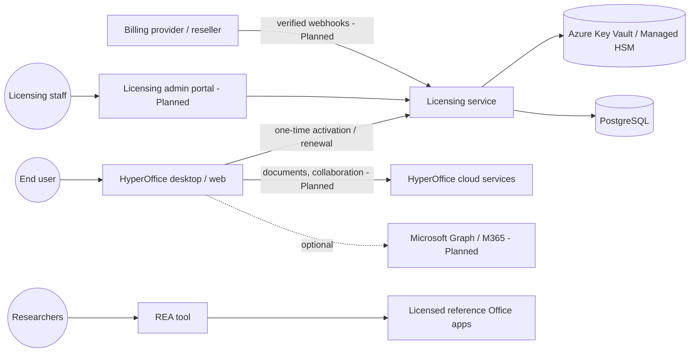
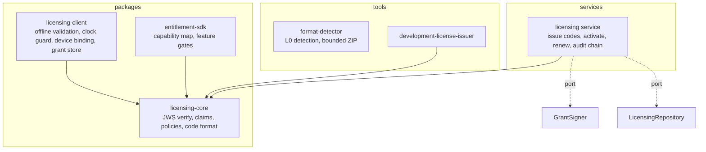
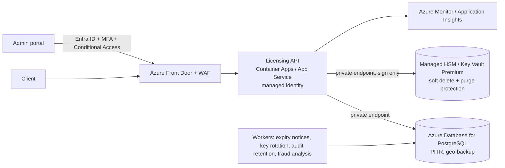

# System Architecture Design (SAD)

| Item | Value |
| --- | --- |
| Version | 0.1 (foundation) |
| Date | 2026-11-18 |
| Baseline | Commit `392d896` |
| Related | [Technical Design](technical-design-document.md), [ADRs](architecture/decisions/README.md), [Target state](architecture/target-state.md) |

## 1. Purpose and scope

Defines the overall architecture of HyperOffice: a cross-platform productivity
suite (HyperDoc, HyperSheet, HyperDeck, HyperPlan, HyperAI, HyperWorkspace) and
its separate commercial licensing system. It distinguishes the **implemented**
baseline from the **target** architecture.

## 2. Architectural goals and constraints

| Goal | Architectural response |
| --- | --- |
| Office format interoperability with honest claims | Capability manifests (L0–L6); REA evidence required above L4 |
| Hostile-file safety | Bounded package readers; sandboxed, network-less conversion workers |
| Offline productivity | Engines run locally (WASM/native); licences verified offline |
| Customer data never held hostage | Data-access capabilities always allowed |
| Security of licensing | Asymmetric signatures; keys only in Azure Key Vault/Managed HSM |
| Privacy | No document content in telemetry or licensing; allowlisted device signals |
| Accessibility and Arabic/RTL | WCAG 2.2 AA; bidi in all models and fixtures |
| Maintainability | Monorepo with explicit package boundaries, ADRs, strict typing |

Constraints: Node.js ≥ 26.12.1; TypeScript strict; Rust stable for engines (not
yet provisioned); Azure as the cloud platform; Microsoft Entra ID for administrators.

## 3. System context

The licensing service is logically and operationally separate from document
services and never receives document data.

## 4. Logical architecture

| Layer | Responsibility | Implemented today |
| --- | --- | --- |
| Presentation | Web (React/Vite), desktop (Tauri 2), HyperWorkspace shell | — |
| Application services | Commands, undo/redo, collaboration ops, entitlement enforcement | `entitlement-sdk` |
| Document engines | Package → semantic model → view model per product | — |
| Package layer | ZIP/OLE, content types, relationships, preservation | `format-detector` (L0) |
| Platform services | Files, conversion, collaboration, search, AI orchestration | — |
| Licensing | Codes, activation, renewal, grants, audit | `licensing-core`, `licensing-client`, `services/licensing` (logic) |

### Document model layering

1. **Package layer** — container, parts, relationships, unknown-part preservation, signatures.
2. **Semantic model** — stable IDs, validation, change tracking.
3. **View/edit model** — selection, commands, layout cache, virtualisation, accessibility tree.

Raw OOXML is never the UI model.

## 5. Component view (implemented)

Ports with only test/development adapters today: `GrantSigner`
(`LocalDevelopmentSigner`), `LicensingRepository` (`InMemoryLicensingRepository`),
`SecureStore` (`MemorySecureStore`), rate limiter (in-memory).

## 6. Deployment view

### Current

Developer workstations and CI runners only. Nothing is deployed.

### Target (Azure)

Document platform services (files, conversion, collaboration) deploy separately
with their own identities; conversion workers run non-root, read-only input,
no network, with CPU/memory/time limits.

## 7. Data architecture

| Store | Data | Classification |
| --- | --- | --- |
| Client secure store | Signed grant, installation ID, trusted-time state, signal hashes | Confidential (device) |
| Licensing PostgreSQL | Customers (opaque IDs), orders, templates, code hashes, licences, installations, grants, audit | Confidential |
| Key Vault / HSM | Signing keys, HMAC pepper | Secret |
| Documents | User files on device / cloud storage | Customer content; never in licensing |

Schema: [services/licensing/migrations/0001_initial.sql](../services/licensing/migrations/0001_initial.sql).

## 8. Security architecture

- **Trust boundaries:** client ↔ gateway; API ↔ database; API ↔ HSM; admin ↔ API; billing ↔ adapter; extension ↔ host.
- **Licensing cryptography:** EdDSA (ES256 fallback) JWS; strict verification; embedded trust stores per environment; key rotation and compromise procedures ([key-management.md](licensing/key-management.md)).
- **Input handling:** package limits, DTD refusal, path-traversal and duplicate rejection ([file-processing.md](security/file-processing.md)).
- **Audit:** SHA-256 hash-chained events; no secrets; database role without UPDATE/DELETE.
- **Abuse resistance:** rate limits per IP/code/installation/fingerprint; uniform errors; idempotency; nonce replay window.
- **Supply chain:** pinned dependencies, lockfile, Dependabot, CodeQL, dependency review, `pnpm audit`.
- Threat model: [licensing/threat-model.md](licensing/threat-model.md).

## 9. Quality attributes

| Attribute | Target | Status |
| --- | --- | --- |
| Licensing API availability | 99.9 % monthly | Not deployed |
| Activation p95 | < 1 s excluding billing | Not measured |
| RPO / RTO | ≤ 15 min / ≤ 4 h | Not implemented |
| Offline operation | Outage never disables activated installs | Implemented in client logic |
| Open 10 MB DOCX | < 3 s | No engine yet |
| Accessibility | WCAG 2.2 AA | No UI yet |

## 10. Technology stack

| Concern | Choice | ADR |
| --- | --- | --- |
| Repository | pnpm 12 workspaces, Turborepo | 0001 |
| Language | TypeScript 5.9 strict; Rust stable (planned) | 0001, 0003 |
| Tests | `node:test`, fast-check, Ajv | 0002 |
| Backend framework | Proposed: Fastify (TS) for control plane, Axum (Rust) for workers | 0005 |
| Licence tokens | JWS EdDSA/ES256 via `node:crypto` | 0102 |
| Key custody | Azure Managed HSM / Key Vault | 0103 |
| Research | REA `rea-agents@6.9.0` | 0004 |

## 11. Architectural risks

| Risk | Impact | Mitigation |
| --- | --- | --- |
| Rust toolchain absent | Engines blocked | Provision in Phase 1 |
| No REA reference environment | No compatibility claims above L0 | Licensed Office VM + approver |
| Ed25519 availability in Key Vault | Algorithm choice | ES256 already supported by clients |
| Offline licences cannot be revoked instantly | Commercial exposure | Disclose; enforce at renewal |
| OneDrive-hosted working copy | Build instability | Move clone to local disk |
